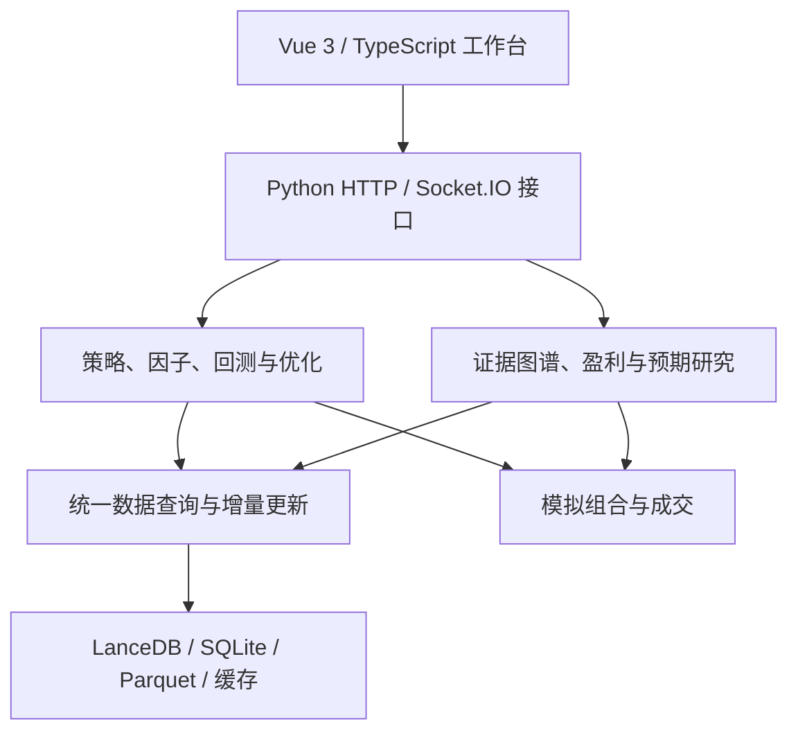

# AquaTrader

面向 A 股的金融数据管理、量化回测与证据驱动研究平台。

项目起源于数据库课程中的数据采集、清洗、入库与可视化实践，逐步扩展为包括行情服务、因子计算、策略开发、参数优化、产业链研究与模拟交易的个人工程项目。本仓库是经隐私清理的源码展示版本，适合课程项目评阅与技术交流。

## 核心能力

| 模块 | 实现内容 |
| --- | --- |
| 数据服务 | 多源行情接入，股票代码与日期标准化，复权与金额口径处理，增量更新、统一查询和数据健康检查 |
| 存储与计算 | LanceDB 行情与因子主源，SQLite 业务元信息，Parquet 与矩阵缓存，Polars/NumPy 向量化处理及可选 Numba 加速 |
| 策略与因子 | 均线、量价、趋势和形态策略；Python 策略类、YAML/JSON 配置规则及策略 DSL |
| 历史回测 | 数据、计算、信号、执行和报告分层；T+1、停牌、涨跌停、手续费、印花税、滑点和成交量限制 |
| 参数优化 | 遗传算法与基于 Optuna 的贝叶斯优化，结合收益、回撤和风险指标评价参数组合 |
| 公司与产业链研究 | 研究主张、文档版本、证据来源、支持与反证的记录及图谱组织；来源血缘去重与研究状态审计 |
| 盈利与预期分析 | 需求、产能、定价及利润假设的区间传播，三情景测算、敏感性分析、内部预测与市场预期比较 |
| 模拟组合 | 组合构建、模拟成交、持仓与结果记录；与历史回测共享成交约束 |
| 可视化工作台 | Vue 3 页面展示策略、K 线、权益曲线、交易明细、公司研究和产业链图谱；Socket.IO 推送任务进度 |

这些模块反映源码中实现的能力，不代表每项能力在任意环境下均可直接运行。完整运行仍需要数据、可选依赖和相应服务配置。

## 系统结构



- `core/quant/`：量化策略、因子、五层回测引擎与参数优化。
- `core/research/`：证据控制面、公司研究、盈利映射、预期差及研究评价。
- `core/research_graph/`：主张与证据图谱、检索、来源追溯与状态更新。
- `core/paper_trading/`：模拟组合和执行模型。
- `data_svc/`：数据供应商、查询、存储与增量更新服务。
- `server/`：业务接口、异步任务与实时进度推送。
- `myapp/`：Vue 3、TypeScript、Vite 前端。
- `integrations/qmt_bridge/`：券商接口契约、风控检查与模拟桥接。
- `test/`、`tests/`：代码中的单元测试与集成验证。

## 研究与回测的可复核性

历史研究采用 point-in-time 过滤，只使用研究时点之前可获得的信息。证据记录包含来源和版本，模型生成的假设与事实证据分开处理。缺字段或证据不足时返回缺口或降级状态。

回测报告包含权益曲线、年化收益、最大回撤、夏普比率、胜率、交易明细及不可成交原因。模拟交易复用成交约束，以减少不同模块对执行规则的理解差异。仓库不包含收益保证或未经测量的性能提升倍数。

## 本地准备

建议在独立环境中安装依赖：

```bash
python -m venv .venv
# Windows: .venv\Scripts\activate
# Linux/macOS: source .venv/bin/activate
pip install -r requirements.txt
cp .env.example .env
```

Windows PowerShell 可使用 `Copy-Item .env.example .env` 复制配置模板。自行在本地填写配置并准备市场数据，切勿提交真实密钥。

后端：

```bash
python -m server.app
```

前端：

```bash
cd myapp
npm ci
npm run dev
```

后端默认使用端口 `5000`，前端默认使用端口 `5173`。数据和可选服务缺失时，部分模块会显示空态、降级状态或依赖提示。此发布副本不是附带完整数据库的一键部署包；部分历史脚本保留通用示例路径，需要按本机环境调整。

## 隐私与发布范围

本仓库使用新的初始提交，不包含原仓库历史。发布内容为代码、技术文档和通用配置，排除了：

- `.env`、登录凭据、访问令牌、真实券商账号和本地私密配置；
- 行情数据库、市场数据文件、持仓及订单运行记录；
- 日志、运行报告、缓存、模型权重及本地依赖；
- 个人截图、附件、临时实验输出和服务器部署记录。

测试中的合成输入及代码中的通用示例不代表真实账户或实盘结果。真实数据需由使用者自行获取和管理。

## 当前边界

QMT 桥接仅提供接口契约、风控校验与 `MockBrokerBridge` 本地模拟验证。真实账户查询、下单与撤单方法尚未实现。仓库中的接口定义和页面名称不能视为已完成实盘交易接入。

项目使用了第三方开源库与数据接口，不代表独立实现了这些依赖。当前发布范围是个人应用代码和系统集成实现。
